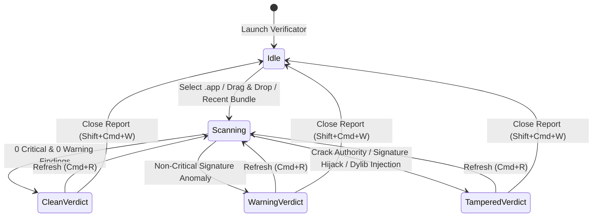

# Symbolic Short-Term Memory Topo-Graph

## Node ID Lookup Table

| Node ID | Component | Source File | Responsibility |
| :--- | :--- | :--- | :--- |
| `N01` | `VerificatorApp` | `Sources/Verificator/VerificatorApp.swift` | Main Window, About Window, Log Window, Settings, Menu Commands |
| `N02` | `AppModel` | `Sources/Verificator/AppModel.swift` | Scan lifecycle (`scan`, `refreshCurrentBundle`, `clearReport`), report export, update checks |
| `N03` | `AppSettings` | `Sources/Verificator/AppSettings.swift` | Language (`tr`/`en`/`ro`), appearance, scan options, recent bundles, custom shortcuts |
| `N04` | `ForensicScanner` | `Sources/VerificatorCore/ForensicScanner.swift` | 4-layer Mach-O, codesign, dylib injection, and hook symbol forensic engine |
| `N05` | `ContentView` | `Sources/Verificator/Views/ContentView.swift` | Header bar with Refresh (`⌘R`), drop zone, verdict banner, 4 forensic tabs |
| `N06` | `SettingsView` | `Sources/Verificator/Views/SettingsView.swift` | General, Scan, Shortcuts, and Engine/Updates settings tabs + restart alert |
| `N07` | `LogView` / `AppLog` | `Sources/Verificator/Views/LogView.swift` | Persistent forensic audit log viewer and Console integration |
| `N08` | `AboutView` | `Sources/Verificator/Views/AboutView.swift` | App metadata, repository links, and read-only license sheets |
