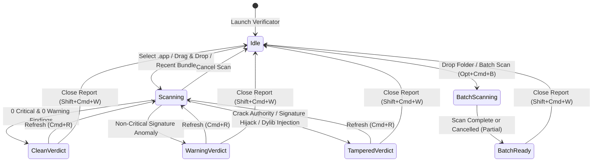

# Symbolic Short-Term Memory Topo-Graph

## Node ID Lookup Table

| Node ID | Component | Source File | Responsibility |
| :--- | :--- | :--- | :--- |
| `N01` | `VerificatorMain` | `Sources/Verificator/VerificatorMain.swift` | Thin app entry point launching `VerificatorApp` |
| `N02` | `VerificatorApp` | `Sources/VerificatorKit/VerificatorApp.swift` | Main Window, About Window, Log Window, Settings, Menu Commands |
| `N03` | `AppModel` | `Sources/VerificatorKit/AppModel.swift` | Scan & parallel batch lifecycle, quarantine removal, report export, verified update installs |
| `N04` | `AppSettings` | `Sources/VerificatorKit/AppSettings.swift` | Language (`tr`/`en`/`ro`), appearance, scan options, recent bundles, custom shortcuts |
| `N05` | `ForensicScanner` | `Sources/VerificatorCore/ForensicScanner.swift` | 4-layer Mach-O, SHA-256, codesign, spctl, lipo, `.appex`/`.xpc`/helper, dylib & hook engine |
| `N06` | `ContentView` | `Sources/VerificatorKit/Views/ContentView.swift` | Header bar (`⌘R`), drop zone, batch audit view, verdict banner, 4 forensic tabs |
| `N07` | `SettingsView` | `Sources/VerificatorKit/Views/SettingsView.swift` | General, Scan, Shortcuts, and Engine/Updates settings tabs + verified update actions |
| `N08` | `LogView` / `AppLog` | `Sources/VerificatorKit/Views/LogView.swift` | Persistent forensic audit log viewer and Console integration |
| `N09` | `AboutView` | `Sources/VerificatorKit/Views/AboutView.swift` | App metadata, repository links, and read-only license sheets |
| `N10` | `VerificatorCLI` | `Sources/VerificatorCLI/main.swift` | Headless CLI (`verificator-cli`) supporting single, `--batch`, `--diff`, `--running`, `--persistence`, `--lang`, `--json`, `--spctl` |
| `N11` | `AuditDiff` & `DiffView` | `Sources/VerificatorCore/AuditDiff.swift`, `Sources/VerificatorKit/Views/DiffView.swift` | Side-by-side comparison of targets or JSON audit reports (`⇧⌘D`) |
| `N12` | `EntitlementAnalyzer` | `Sources/VerificatorCore/EntitlementAnalyzer.swift` | Informational security entitlement badge classifier (non-verdict-mutating) |
| `N13` | `SystemAudit` & `SystemAuditView` | `Sources/VerificatorCore/SystemAudit.swift`, `Sources/VerificatorKit/Views/SystemAuditView.swift` | Running processes (`proc_listallpids` / `KERN_PROCARGS2` / `LiveProcessInspector`, `⌥⌘P`) & persistence (`⌥⌘T`) auditor |
| `N14` | `VerificatorIntents` | `Sources/VerificatorKit/VerificatorIntents.swift` | Shortcuts & Spotlight `AppIntents` (`AuditApplicationIntent`, `VerificatorShortcutsProvider`) |
| `N15` | `SystemSecurityChecks`, `SignatureTracker`, `ChildProcessGuard` | `Sources/VerificatorCore/{SystemSecurityChecks,SignatureTracker,ChildProcessGuard}.swift` | Gatekeeper status, FDA probe, OCSP revocation, signature/CDHash history, live memory verification, orphan child reaping |
| `N16` | `LaunchServicesRegistration` | `Sources/VerificatorKit/LaunchServicesRegistration.swift` | Per-version-build `LSRegisterURL` bundle registration at app startup |
