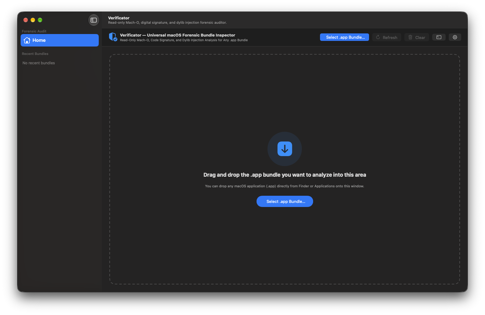

# Verificator

  

A native macOS 26+ forensic application bundle (`.app`) inspector, built with SwiftUI and Liquid Glass as a universal app (Apple Silicon `arm64` + Intel `x86_64`). It performs read-only 4-layer Mach-O, code signature, and dylib injection analysis with **0% false positives** on legitimate Apple, App Store, Developer ID, and local developer builds.

<p align="center">
  
</p>

## Features

- **4-Layer Zero False-Positive Forensic Engine (`ForensicScanner`)**
  - **Layer 1 — Code Signature & Authority Chain:** runs `codesign -dvvv` and `codesign --verify --no-strict` to inspect `TeamIdentifier`, certificate authority chains (`Apple Root CA`, `Developer ID Application`), Hardened Runtime flags, Notarization tickets, `CDHash`, and unofficial self-signed crack certificates (such as `TEAM EDiSO`).
  - **Layer 2 — Signature Hijacking Detection:** compares the signing provenance of frameworks inside `Contents/Frameworks` and `Contents/MacOS` against the main executable to detect bundles whose vendor signature was stripped and replaced after injecting a third-party dylib.
  - **Layer 3 — Mach-O Load Command Audit (`otool -L`):** inspects `LC_LOAD_DYLIB` and `LC_LOAD_WEAK_DYLIB` links on the main executable without false-flagging legitimate CMake, Electron, or SwiftPM libraries.
  - **Layer 4 — Runtime Hook & Memory Patch Symbol Categorization (`nm -u`, `strings`):** categorizes imported hook symbols into Objective-C method swizzling (`_method_exchangeImplementations`, `_class_replaceMethod`), Mach VM patching (`_mach_vm_protect`, `_mach_vm_write`, `_mach_vm_remap`), and DYLD ASLR slide inspection (`__dyld_get_image_vmaddr_slide`).
- **On-Device & Local AI Forensic Assessment (`ForensicAI`)**
  - Summarizes and interprets forensic findings in the selected language without altering the deterministic verdict (`CLEAN`, `WARNING`, `TAMPERED`).
  - Supports **Apple Intelligence** (first and default provider on macOS 26+ via `FoundationModels`), local **Ollama** (`127.0.0.1:11434`), local **LM Studio** (`127.0.0.1:1234`), and **Automatic (in order)** fallback.
  - Strict security boundaries: exclusively talks to `127.0.0.1` with proxy/redirects disabled; filters out cloud/embedding models; warns with an amber badge if a chosen provider is unavailable instead of silently falling back.
- **Quarantine Removal (`sudo xattr`)**
  - Dynamically displays a prominent **Remove Quarantine** button when `com.apple.quarantine` is present on the bundle or its executable.
  - Uses macOS administrator authentication (`Touch ID` / password prompt) to safely clear quarantine flags and immediately re-audits the bundle.
- **Master–Detail Interface (`NavigationSplitView`)**
  - Sidebar with forensic inspection sections (**Home**, **Overview & Signature** `⌘1`, **Mach-O & Dylib Analysis** `⌘2`, **Memory & Hook Symbols** `⌘3`, **Raw Forensic Output** `⌘4`) and **Recent Bundles** with live app icons, verdict indicators, and context menus.
  - Prominent **Refresh (`⌘R`)** and **Clear (`⇧⌘W`)** buttons in the header bar, verdict banner, and menu bar.
  - One-click Markdown report copy (`⇧⌘C`) and `.md` file export (`⌘S`).
- **Languages:** Turkish (default), English, Romanian (1:1 key parity across dedicated `.lproj` files)
- **Appearance:** System, Light, Dark
- **Windows:** Main Window, 4-tab Settings (`⌘,`), About with read-only License Viewer, and a Console-style Log window (`⌥⌘L`) backed by `~/Library/Logs/Verificator/Verificator.log`
- **Updates:** checks GitHub Releases (`AppUpdateChecker`) and supports Ed25519 signature (`UpdateSignature`) and SHA-256 checksum (`UpdateChecksums`) verification.

## Installation

**Requires:** macOS 26 (Tahoe) or later. Runs natively on Apple Silicon and Intel Macs.

1. Download the latest `Verificator-<version>.dmg` from the [Releases](https://github.com/berkbb/verificator-mac-universal/releases) page.
2. Optionally verify the download with `SHA256SUMS.txt`:
   ```bash
   shasum -a 256 -c SHA256SUMS.txt
   ```
3. Open the `.dmg` and drag **Verificator** into the **Applications** folder.
4. **First launch & Gatekeeper Quarantine:** Verificator is ad-hoc signed rather than signed with a paid Apple Developer ID and is not notarized by Apple. When a file is downloaded from the internet, macOS automatically attaches the `com.apple.quarantine` extended attribute to it, and Gatekeeper blocks quarantined apps that are not notarized, displaying an alert such as *"Verificator can't be opened because Apple cannot check it for malicious software"*.
   - **Method A (GUI):** Right-click (or Control-click) `Verificator.app` in `/Applications`, choose **Open**, and click **Open** in the confirmation dialog (only required once). Alternatively, allow it in **System Settings › Privacy & Security** (scroll to *"Verificator was blocked..."* and click **Open Anyway**).
   - **Method B (Terminal):** Remove the quarantine attribute manually from the downloaded app:
     ```bash
     xattr -dr com.apple.quarantine /Applications/Verificator.app
     ```
   - **DMG Quarantine:** On newer macOS versions, Gatekeeper may also block opening the downloaded `.dmg` disk image directly. If prompted, allow it in **Privacy & Security**, or strip the quarantine flag prior to mounting:
     ```bash
     xattr -d com.apple.quarantine ~/Downloads/Verificator-*.dmg
     ```

## Development

Double-click in Finder:

- **`Paketle.command`** (package): runs the test suite and produces a universal `build/Verificator.app` plus a `.dmg`, an Ed25519 signature (`.dmg.sig`), and a `SHA256SUMS.txt` checksum file under `dist/`.
- **`Yayimla.command`** (publish): first shows what it will do in dry-run mode. If you confirm, it packages the release and uploads it to GitHub Releases with a `v<version>` tag.

The same tasks from the terminal:

```bash
./Scripts/package.sh                  # tests + universal .app + .dmg + .dmg.sig + SHA256SUMS.txt
./Scripts/build_app.sh                # build/Verificator.app only
./Scripts/set-version.sh 1.1.1        # bump version (single source: Support/Info.plist)
./Scripts/release.sh --dry-run        # rehearse a release without sending anything
./Scripts/release.sh                  # package, tag and upload to GitHub Releases
swift test                            # run all unit, localization & forensic calibration tests
```

Requires Xcode 26 or later. See [DEVELOPMENT.md](DEVELOPMENT.md) for architecture details, [roadmap.md](.agents/context/roadmap.md) for milestones, and [CHANGELOG.md](CHANGELOG.md) for release notes. Coding agents start from [.agents/AGENTS.md](.agents/AGENTS.md); the local code knowledge graph is built with [Graphify](https://github.com/Graphify-Labs/graphify).

## License & Third-Party Notices

Verificator is licensed under the **GNU General Public License, version 3 only** ([GPL-3.0-only](LICENSE)); Copyright (C) 2026 Babadogan Tech and Edu. It comes with no warranty.

See [THIRD_PARTY_NOTICES.md](THIRD_PARTY_NOTICES.md) for system tool and framework attributions.
